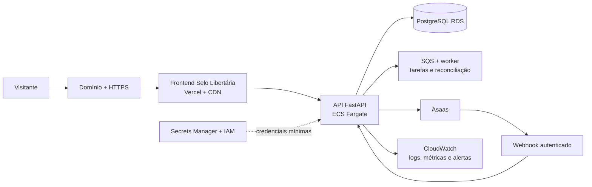
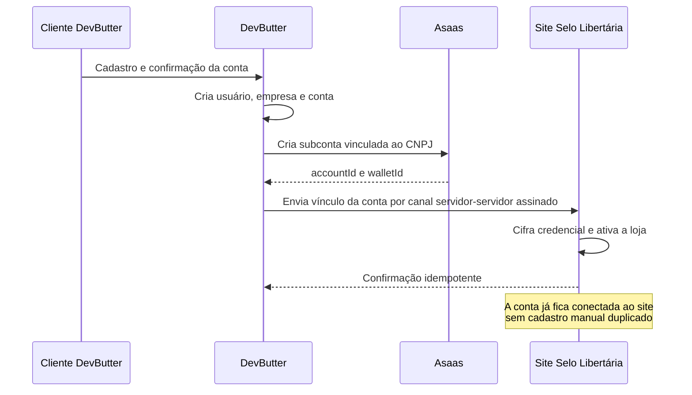
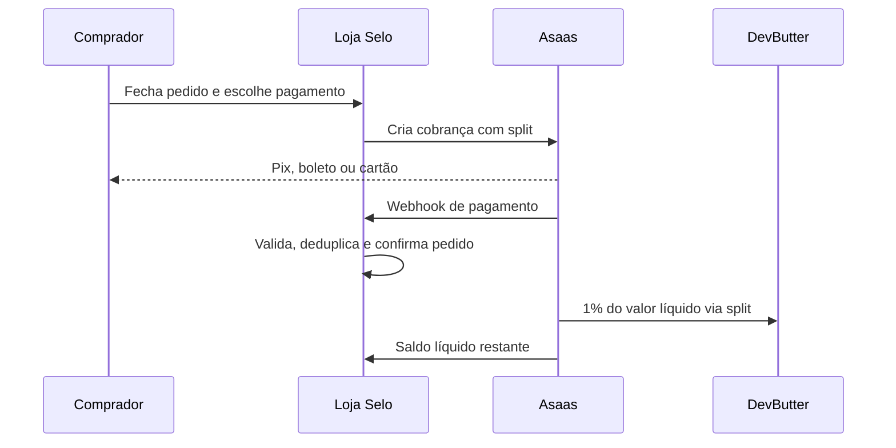

# DevButter na AWS para o Selo Libertária

**Proposta de operação:** o Selo Libertária terá site, loja, pagamentos e administração conectados a uma plataforma gerenciada. Para os três primeiros sites, o frontend fica em **Vercel** e os serviços de negócio ficam na **AWS**. A DevButter assume o custo da infraestrutura no primeiro ano. A partir do 13º mês, a mensalidade é **R$ 40,00**, somada a uma comissão operacional de **1% sobre o valor líquido de cada venda paga**.

> Este é um documento de apresentação e projeção. A AWS ainda não foi provisionada; portanto, os valores são estimativas de planejamento, não uma fatura ou promessa de custo fixo. A cotação final deve ser salva na AWS Pricing Calculator antes da contratação.

## 1. O que melhora para o Selo

- **Uma operação só:** presença institucional, catálogo, loja, pedidos e administração ficam integrados.
- **Mais autonomia:** a equipe atualiza conteúdo, produtos, agenda e pedidos sem depender de alterações manuais no código.
- **Pagamento acompanhado:** cada pedido tem estado, histórico e reconciliação; a confirmação vem do provedor, não da tela do cliente.
- **Base para crescer:** a mesma estrutura suporta novos produtos, campanhas e mais acessos sem recomeçar a plataforma.
- **Operação mensurável:** alertas, logs e acompanhamento de disponibilidade tornam falhas visíveis e rastreáveis.

## 2. Estrutura enxuta: Vercel para sites, AWS para a plataforma

| Camada | Responsabilidade | Ganho prático |
|---|---|---|
| Vercel e CDN | entrega do site, preview de cada alteração e ambientes lógicos | páginas ágeis sem servidores ociosos |
| ECS Fargate | executa API e worker compartilhados, sem administrar servidores | atualização e escala controladas |
| RDS PostgreSQL | usuários, catálogo, pedidos e auditoria | dados consistentes, backup e restauração |
| SQS | fila tarefas não imediatas, como reconciliação | falhas temporárias não perdem eventos |
| CloudWatch | logs, métricas e alarmes | diagnóstico e resposta mais rápidos |
| IAM e Secrets Manager | menor privilégio e segredos fora do código | reduz exposição de credenciais |

Cada cliente terá `staging`, `pré-produção` e `produção`, mas isso não significa nove servidores permanentes. Na Vercel, ambientes de teste são deployments que praticamente não consomem quando estão sem uso. Kubernetes/EKS não será usado nesta fase: adicionaria custo e operação sem resolver um problema atual.

O banco Mongo/DocumentDB do legado do Selo é temporário. A migração completa para PostgreSQL reduz o custo e simplifica a operação.

## 3. Criação de cliente, conta e conexão automática com o Selo

1. A pessoa cria uma conta na DevButter e confirma o cadastro.
2. A plataforma registra a empresa e a conta comercial.
3. Para empresas com **CNPJ** e aprovação necessária, a DevButter provisiona a subconta Asaas e recebe o identificador de carteira (`walletId`).
4. O backend do Selo recebe somente o vínculo necessário por comunicação entre servidores, verifica a assinatura e guarda a credencial cifrada.
5. A loja do Selo passa a criar cobranças na conta vinculada automaticamente. A equipe não repete cadastro, chave ou configuração de pagamento.

**Limite importante:** a criação de subconta por API da Asaas é destinada a CNPJ e pode passar por análise cadastral. Enquanto houver pendência ou rejeição, a conta não deve anunciar pagamento como disponível.

## 4. Compra, repasse e comissão de operação

- A Asaas cobra a tarifa do meio de pagamento conforme o contrato da conta do Selo; essa tarifa é do provedor e **não é receita da DevButter**.
- A comissão DevButter é um **split de 1% do valor líquido**: depois da tarifa Asaas, 1% do saldo líquido é repassado para a carteira DevButter e o restante fica com o Selo.
- A taxa só incide quando o pagamento é efetivamente liquidado. Pedido pendente, recusado, cancelado ou estornado não gera comissão líquida definitiva.
- O split percentual da Asaas é calculado sobre o `netValue` (valor após tarifas). Logo, a comunicação comercial deve dizer “**1% do valor líquido recebido**”, e não “1% do valor bruto”.

### Exemplo simples

Venda de R$ 100,00; supondo tarifa Asaas de R$ 3,00: valor líquido R$ 97,00. A comissão DevButter é **R$ 0,97** e o Selo recebe **R$ 96,03**. A tarifa real varia por meio de pagamento e contrato Asaas.

## 5. Investimento da cliente e sustentabilidade operacional

| Período | Mensalidade do Selo | Comissão DevButter | Quem sustenta a infraestrutura |
|---|---:|---:|---|
| Meses 1 a 12 | R$ 0,00 | 1% do líquido de vendas pagas | DevButter assume o custo base |
| A partir do mês 13 | R$ 40,00/mês | 1% do líquido de vendas pagas | mensalidade + comissão ajudam a financiar a operação |

### Custo mensal projetado da operação inicial

Premissas: três sites de baixo tráfego, cerca de 75 mil requisições web/mês somadas, 40 GB de transferência, 100 builds de três minutos, uma API/worker AWS compartilhada e câmbio de planejamento de **R$ 5,50/USD**. Não inclui impostos, domínio, e-mail, IA, mão de obra ou tarifas Asaas.

| Componente | USD/mês | R$/mês | Observação |
|---|---:|---:|---|
| Vercel Pro para os três sites | 20 | 110 | previews, staging, pré-produção e produção sem servidores permanentes por ambiente |
| AWS: API/worker compartilhados, logs e rede básica | 50–100 | 275–550 | faixa de planejamento; depende de banco, tráfego e arquitetura final |
| **Plataforma inicial completa** | **70–120** | **385–660** | para os três clientes, não por cliente |
| **Referência por cliente (rateio em três)** | **23–40** | **128–220** | custo operacional, antes de impostos e serviços opcionais |

O modelo inicial mais provável é **cerca de R$ 141/mês por cliente** (R$ 423/mês pela plataforma, no ponto médio). Os R$ 40,00 não pagam toda a infraestrutura sozinhos; são uma contribuição de permanência. A comissão de 1% financia a diferença conforme há venda.

Uma arquitetura AWS integral com vários contêineres, ALB, NAT e banco dedicado pode passar de R$ 2.600/mês. Ela não é a escolha recomendada neste estágio e só deve ser adotada quando tráfego, disponibilidade ou isolamento exigirem.

### Quanto a comissão precisa movimentar para cobrir a operação?

Fórmula: `vendas líquidas necessárias = (custo mensal - R$ 40) ÷ 1%`.

| Base de custo | Vendas líquidas/mês para equilíbrio após o 1º ano | Comissão de 1% |
|---|---:|---:|
| R$ 128 — rateio econômico | R$ 8.800 | R$ 88 |
| R$ 141 — referência de planejamento | R$ 10.100 | R$ 101 |
| R$ 220 — teto inicial prudente | R$ 18.000 | R$ 180 |
| R$ 423 — plataforma toda, se tivesse apenas um cliente | R$ 38.300 | R$ 383 |

No primeiro ano, sem mensalidade, a referência de R$ 141 exige R$ 14.100 em vendas líquidas/mês para que a comissão de 1% cubra sozinha a parcela operacional do Selo. Esses números deixam explícito o modelo: a DevButter subsidia a entrada, e a operação fica saudável conforme o volume de vendas e o custo real observado.

## 6. Segurança e confiabilidade

- HTTPS em toda entrada pública; a comunicação interna usa rede privada e identidades de serviço.
- Credenciais guardadas no Secrets Manager ou cifradas no banco; nunca no frontend, repositório ou logs.
- Permissões IAM por serviço, sem uma chave geral compartilhada.
- Webhooks com assinatura, janela de tempo, nonce e comparação em tempo constante; eventos repetidos são processados uma vez.
- Pagamentos são confirmados pelo webhook do provedor e reconciliados por worker; o navegador não decide pagamento aprovado.
- Backups, logs estruturados, alarmes de erro e de custo, com orçamento AWS alertando em 50%, 80% e 100% do teto definido.
- Atualizações em contêineres versionados, com migration controlada antes do rollout e possibilidade de reversão do serviço.

Nenhum número de segurança dispensa homologação: antes de produção, são obrigatórios testes Sandbox Asaas, validação de webhooks, backup/restauração e smoke test ponta a ponta.

## 7. Decisões antes da contratação

1. Contratar Vercel Pro e criar os três ambientes lógicos por cliente; não criar Kubernetes.
2. Confirmar região, câmbio, impostos e criar a estimativa salva na AWS Pricing Calculator para a API compartilhada.
3. Concluir a migração do Mongo/DocumentDB para PostgreSQL antes de assumir custo recorrente maior.
4. Confirmar com a Asaas as condições da subconta, do split e do gerenciamento/rotação de token.
5. Formalizar que a comissão é **1% do líquido**, além das tarifas próprias da Asaas.
6. Implantar primeiro em Sandbox/staging; produção apenas após a validação completa de pagamento e segurança.

## Fontes

- [Estimativa AWS existente da DevButter e Selo Libertária](../../devbutter_app/docs/estimativa-custos-aws-devbutter-selolibertaria.md) — referência financeira adotada neste material.
- [Preços AWS Fargate](https://aws.amazon.com/pt/fargate/pricing/) — cobrança por vCPU, memória e tempo de execução.
- [Vercel Pro](https://vercel.com/docs/plans/pro) — plano de hospedagem e créditos incluídos.
- [Preços AWS Fargate](https://aws.amazon.com/pt/fargate/pricing/) e [AWS VPC](https://aws.amazon.com/pt/vpc/pricing/) — infraestrutura da API, rede e cobrança por uso.
- [Documentação Asaas de Split](https://docs.asaas.com/docs/split-de-pagamentos) — percentual calculado sobre o valor líquido.
- [Taxas Asaas](https://www.asaas.com/precos-e-taxas) — tarifas dependem do meio de pagamento e do contrato da conta.
