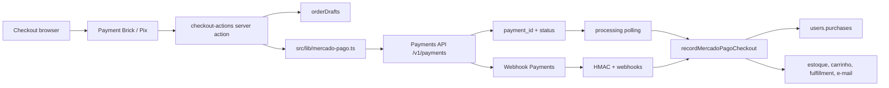
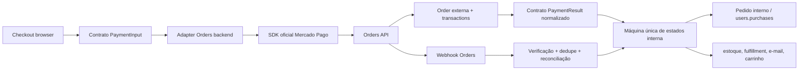

# DEV-152 — Mapa da integração legada da Payments API (Mercado Pago)

Inventário verificado em 2026-07-23 antes da implementação da Orders API. Esta fase não
altera código de produção.

## Resumo arquitetural

O fluxo atual usa `fetch` direto para `https://api.mercadopago.com`, sem o pacote oficial
`mercadopago` em `package.json`. O backend cria e consulta pagamentos em `/v1/payments`,
gerencia cartões salvos em `/v1/customers` e expõe ao frontend somente o necessário para
Bricks, Pix e retomada do checkout.

## Matriz de migração por arquivo

| Arquivo/área | Papel atual | Classificação | Próxima fase |
|---|---|---|---|
| `src/lib/mercado-pago.ts` | Client HTTP, DTOs Payments, criação/consulta, customers/cards, Pix, status, assinatura e validação de resposta | **precisa de contrato/mock temporário**; DTOs não devem vazar | DEV-153/154/155 |
| `src/actions/checkout-actions.ts` | Cria `orderDrafts`, valida snapshot, comprador/frete, Pix/cartão, parcelamento, tokenização e cartões salvos | **reutilizável com adaptação pequena** | DEV-156 |
| `src/actions/mercado-pago-order-actions.ts` | Consulta pagamento, reconcilia draft/purchase, atualiza fulfillment, estoque/carrinho e e-mail | **reutilizável com adaptação pequena**; reconciliação incompatível será reconstruída | DEV-156/157 |
| `src/app/api/mercado-pago/webhook/route.ts` | Recebe evento, valida HMAC, registra `webhooks`, busca pagamento e atualiza draft | **reutilizável com adaptação pequena**; payload de Orders exige novo adapter | DEV-155/157 |
| `src/app/checkout/mercado-pago-checkout-form.client.tsx` | Carrega MercadoPago.js, cria Payment Brick, coleta token, Pix e cartão salvo | **reutilizável com adaptação pequena** | DEV-151 |
| `src/app/checkout/mercado-pago-checkout-form.client.test.tsx` | Contrato do formulário, validações e estados de checkout | **reutilizável com adaptação pequena** | DEV-151 |
| `src/app/checkout/page.tsx` | Inicializa a intenção transparente e renderiza o formulário | **reutilizável sem alteração** | DEV-156/151 |
| `src/app/checkout/checkout-form.client.tsx` | Shell, comprador, endereço e seleção de entrega | **reutilizável sem alteração** | DEV-156 |
| `src/app/checkout/processing/page.tsx` | Polling/reconciliação pós-tentativa e limpeza otimista do carrinho | **reutilizável com adaptação pequena** | DEV-156/157 |
| `src/app/checkout/return/route.ts` | Normaliza retorno legado com `order`, `mp_payment`, `payment_id` e cancelamento | **incompatível — reconstruir** se Orders não retornar os mesmos parâmetros | DEV-157 |
| `src/components/checkout-success-handler.client.tsx` | Converte parâmetros de retorno em toast/status | **reutilizável com adaptação pequena** | DEV-157 |
| `src/lib/checkout/mercado-pago-idempotency.ts` | Fingerprint de pedido, carrinho, frete, destino, método e comprador | **reutilizável sem alteração** | DEV-153/155 |
| `src/lib/payment-status.ts` | Máquina de estados interna e estados autorizados para checkout/purchase | **reutilizável sem alteração**; ampliar somente com contrato aprovado | DEV-153/156 |
| `src/lib/order-identity.ts` | ID `ord_...` e vínculo legado por `relatedIds.mercadoPagoPaymentId` | **reutilizável com adaptação pequena** | DEV-156/157 |
| `src/actions/order-actions.ts` | Leitura de pedido e limpeza de carrinho após compra | **reutilizável sem alteração** | DEV-156 |
| `src/app/admin/orders/[id]/page.tsx` | Consulta pedido, pagamento, fulfillment e auditoria | **reutilizável sem alteração** | DEV-156 |
| `src/app/api/admin/orders/[id]/fulfillment/route.ts` | Atualiza fulfillment administrativo | **reutilizável sem alteração** | DEV-156 |
| `src/app/admin/webhooks/page.tsx` + `src/app/api/admin/webhooks/route.ts` | Lista e filtra auditoria de webhooks | **reutilizável com adaptação pequena** | DEV-156/157 |
| `src/lib/order-audit.ts` | Eventos de auditoria do pedido | **reutilizável sem alteração** | DEV-156 |
| `src/lib/order-status-notification.ts` | Notificações de mudança de status | **reutilizável com adaptação pequena** | DEV-156/157 |
| `src/lib/order-received.ts` e email transacional | Envia confirmação de pedido após estado elegível | **reutilizável sem alteração** | DEV-156 |
| `src/lib/mongodb.ts` + `src/lib/authz.ts` | Persistência e autorização dos fluxos | **reutilizável sem alteração** | DEV-156 |
| `src/env.mjs` e `.env.example` | Access token, public key, segredo HMAC, Mongo e JWT | **reutilizável com adaptação pequena**; adicionar apenas variáveis Orders aprovadas | DEV-154/155 |
| `src/lib/mercado-pago.test.ts` | Status, Pix, cartões, assinatura HMAC e integridade da resposta | **reutilizável com adaptação pequena** | DEV-153/155/151 |
| `src/lib/checkout/mercado-pago-idempotency.test.ts` | Estabilidade e mudança da chave por tentativa | **reutilizável sem alteração** | DEV-153/155 |
| `src/lib/checkout-processing-status.test.ts` | Estados de processamento/retorno | **reutilizável com adaptação pequena** | DEV-157 |
| `src/app/api/mercado-pago/webhook/route.test.ts` | **Não existe**; cobertura atual é indireta | **precisa de contrato/mock temporário** | DEV-153/155/157 |
| `scripts/create-webhooks-indexes.mjs` | Índices Mongo da coleção `webhooks` | **reutilizável sem alteração** | DEV-156/157 |
| `docs/mercado-pago-sandbox-test.md` | Evidência de sandbox e bloqueio `403/4390 Payer email forbidden` | **dúvida — validar em sandbox/documentação** | DEV-154/148 |
| `AGENTS.md`, `SPEC.md`, `TODO.md`, `UI_UX_PATTERNS.md` | Regras, contratos e contexto operacional | **reutilizável sem alteração**; atualizar somente decisões aprovadas | Todas |

## Fluxos e dados legados

### Checkout logado e convidado

1. `createTransparentCheckoutIntent` lê o snapshot do carrinho e cria/recupera um
   `orderDrafts` por `checkoutOwnerKey`.
2. O draft recebe `orderId` interno (`ord_...`), `paymentReferenceId` (`mp_draft_...`),
   comprador, endereço, frete, total, moeda e hash do carrinho.
3. Usuário logado pode associar `mercadoPagoCustomerId` e cartões mascarados; visitante
   continua tokenizando no browser e é associado ao usuário/pedido na reconciliação.
4. O server action valida que carrinho, moeda, frete e total ainda coincidem antes de
   chamar o provedor.

### Pix, cartão, parcelamento e retries

- Pix usa `payment_method_id: "pix"`; QR Code, copia e cola, ticket e expiração são lidos
  de `point_of_interaction.transaction_data`.
- Cartão usa Payment Brick/MercadoPago.js para token; o backend recebe token, método,
  parcelas, e-mail e identificação, nunca PAN/CVV.
- Cartão salvo busca um token transitório do customer do Mercado Pago; o site persiste
  somente identificador, bandeira, últimos quatro dígitos e expiração.
- Tentativa falha limpa o payment id e permite novo envio; a idempotência é baseada no
  fingerprint da tentativa e não deve ser reutilizada para parâmetros diferentes.
- Não há fluxo separado de cancelamento/estorno implementado no legado; DEV-157 deve
  construir esses casos sobre Orders API.

### Identificadores e idempotência

- `payment_id`/`mercadoPagoPaymentId`: identificador externo legado.
- `external_reference`: recebe o `orderId` interno e é conferido antes da reconciliação.
- `metadata.orderId`/`metadata.userId`: fallback de vínculo e identificação do comprador.
- `mp:{orderId}:{fingerprint}:{attemptId}`: chave de idempotência local da tentativa.
- `relatedIds.mercadoPagoPaymentId`: vínculo persistido no pedido final e compatibilidade
  com buscas legadas.

### Webhooks, assinatura e estados

O endpoint registra o corpo e headers em `webhooks`, deriva o id do pagamento de `data.id`
ou parâmetros compatíveis, valida `x-signature`/`x-request-id` com HMAC quando o segredo
existe, consulta o pagamento e compara moeda, valor e `external_reference`. Em seguida
atualiza o draft e chama a reconciliação idempotente. A deduplicação atual depende da
checagem do draft/purchase finalizado e do `eventId`; deve virar uma política explícita no
contrato de Orders.

Estados externos são traduzidos em `succeeded`, `processing`, `failed`, `disputed`,
`refunded` ou `cancelled`; o domínio usa `payment-status.ts` para decidir checkout,
fulfillment, e-mail e limpeza do carrinho.

## Persistência e efeitos de domínio

| Coleção/registro | Dados relevantes | Efeitos |
|---|---|---|
| `orderDrafts` | `orderId`, `paymentProvider`, ids externos, status, snapshot de carrinho/frete/comprador, tentativa e erro | Protege contra carrinho alterado e reprocessamento; fonte do checkout pendente |
| `users.purchases[]` | pedido, status, pricing, `relatedIds`, fulfillment, eventos | Pedido final, histórico da conta e fonte do admin |
| `users.mercadoPagoCustomerId` | id do customer no provedor | Cartões salvos PCI-safe; não armazenar cartão bruto |
| `webhooks` | evento, provider, id, raw, verified, status, erro, timestamps | Auditoria e deduplicação |
| estoque/carrinho | snapshot interno, baixa/limpeza após confirmação | Não deve depender de DTO do provedor |
| e-mail/fulfillment | `ensureOrderReceivedEmail`, status recebido e rastreio | Executar uma vez por transição elegível |

## Diagrama do fluxo atual

## Diagrama do fluxo-alvo

## Contratos que devem permanecer estáveis

- Snapshot interno de carrinho, comprador, endereço, frete, moeda e total.
- `orderId` imutável e `external_reference` como vínculo externo.
- Estados normalizados consumidos por checkout, processing, pedido, fulfillment e e-mail.
- Pedido interno como fonte de verdade de catálogo, estoque, comprador e entrega.
- Tokens transitórios no frontend/backend; nunca PAN, CVV ou dados brutos de cartão.
- Idempotência por parâmetros reais da tentativa e reconciliação sem duplicar efeitos.
- Auditoria de webhooks e eventos do pedido, com erros normalizados sem expor segredo.

## Classificação por decisão

- **Reutilizar:** carrinho, comprador, endereço, frete, pedido, estoque, conta, fulfillment,
  e-mail, autorização, Mongo, identidade interna, idempotência e estados normalizados.
- **Adaptar:** server actions, webhook, reconciliação, admin de webhooks, retorno/polling e
  testes que hoje dependem de `payment_id`/Payments API.
- **Mockar primeiro:** criação, consulta, cancelamento, estorno, refund e eventos da Orders;
  também o client de infraestrutura e respostas de transação.
- **Reconstruir:** tradução de Orders/transactions quando não houver equivalência segura,
  cancelamento/estorno, reconciliação em lote e qualquer retorno incompatível do checkout.
- **Remover após homologação:** chamadas `/v1/payments`, DTOs Payments, fallback silencioso
  para Payments e compatibilidade de parâmetros que não forem necessários ao rollback.
- **Validar:** cobertura real do SDK, formato de Orders/webhooks, sandbox compatível e
  homologação de Pix, cartão, parcelas, recusas, cartões salvos, cancelamento e estorno.

## Riscos, lacunas e ordem de implementação

1. O SDK oficial não está instalado; DEV-154 deve validar versão, endpoints e tipos antes do
   adapter real.
2. O teste sandbox existente falhou com `403`, código `4390`, `Payer email forbidden`, por
   incompatibilidade entre token/usuários; não tratar isso como defeito do checkout.
3. Não há teste isolado do endpoint de webhook nem casos completos de cancelamento/estorno;
   DEV-153 deve criar mocks e DEV-157 deve adicionar cobertura equivalente.
4. Implementar DEV-153 (contratos/mocks), DEV-154 (SDK), DEV-155 (adapter), DEV-156
   (reconexão), DEV-157 (reconstrução), depois DEV-151 e as homologações DEV-148/DEV-150.
5. Nenhuma chamada nova à Orders API deve ser feita antes da aprovação deste mapa.
