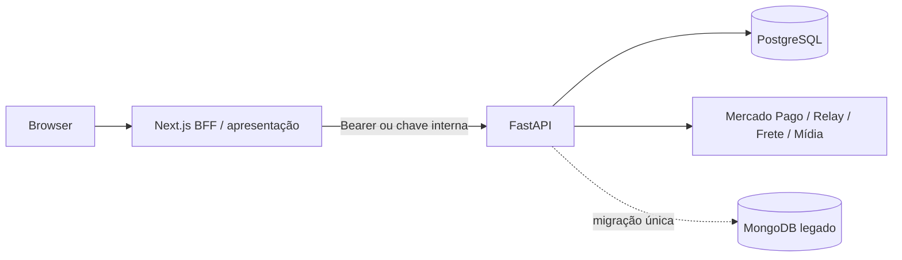

# Prompt 00 — governança e contrato comum

Você está trabalhando na migração do Selo Libertária para a arquitetura:

## Objetivo

Estabelecer a fronteira definitiva antes de editar código.

## Decisões obrigatórias

- Next.js pode manter páginas, Server Components, Server Actions, cookies,
  redirects, headers, CSRF e Route Handlers BFF finos.
- Next.js não pode manter regra de negócio, persistência, integração externa,
  token de provedor, PAN/CVV, segredo, job ou autorização como fonte de verdade.
- FastAPI é autoridade para identidade, autorização, carrinho, preço,
  catálogo, pedidos, checkout, pagamentos, frete, editorial, promoções,
  comunicação, mídia e auditoria.
- Contratos públicos usam `snake_case`; adaptadores TypeScript convertem apenas
  na borda. Erros devem ter código estável e mensagem segura.
- Toda rota administrativa exige bearer de usuário com RBAC ou chave interna
  estritamente limitada ao tráfego server-to-server.
- O webhook Mercado Pago chama FastAPI diretamente e valida assinatura,
  idempotência e integridade antes de alterar pedido.
- O navegador pode carregar apenas o SDK público do Mercado Pago; nunca recebe
  access token, chave interna, segredo OAuth ou credencial de frete.

## Procedimento

Mapeie antes de editar: endpoint, consumidor, schema, persistência, segredo,
teste e prova operacional. Liste arquivos exatos e pare se o contrato existente
não puder ser preservado sem compatibilidade explícita.

## Saída exigida

Produza um plano curto com:

- contrato atual e contrato alvo;
- arquivos backend e frontend que serão tocados;
- migração de dados necessária;
- testes unitários, contrato e integrado;
- riscos e bloqueios.

Não implemente neste prompt.
