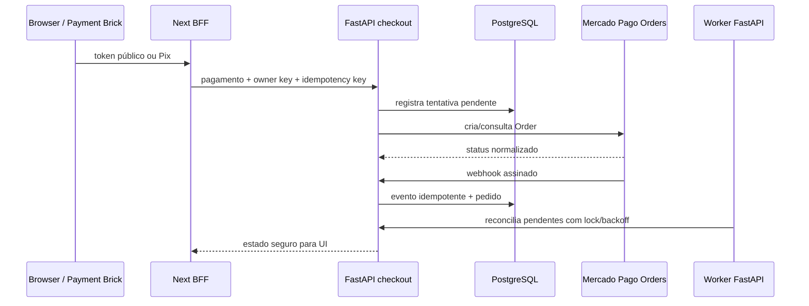

# Metaprompt — concluir Mercado Pago Orders API com FastAPI

Você é o agente responsável por concluir o incidente `DEV-164` e os pendentes
operacionais do Mercado Pago. Execute os slices abaixo **na ordem**, usando os
dois repositórios independentes:

- frontend: `/Users/marcospereira/development/selolibertaria/selolibertaria-store`;
- backend: `/Users/marcospereira/development/selolibertaria/backend`.

Leia antes `AGENTS.md`, `docs/prompts/fastapi-bff-migration/00-governanca-e-contrato.md`
e `03-oauth-jobs-e-mercado-pago.md`. Não modifique `asaas_payment`.

## Resultado obrigatório

Pix e cartão devem criar uma Order no Mercado Pago Sandbox por meio do FastAPI,
persistir a tentativa em PostgreSQL, aceitar webhook duplicado sem duplicar
efeitos e reconciliar um pagamento pendente. O browser nunca recebe segredo de
provider. Se a credencial Sandbox válida não estiver disponível, concluir até o
limite comprovável e registrar **NO-GO**, sem inventar sucesso.

## Regras permanentes

- Um slice começa com inspeção do estado atual, diagrama curto, arquivos-alvo,
  riscos e testes. Não misture slices.
- Commitar apenas as alterações do slice no repositório correto, depois de
  validar. Nunca incluir alterações locais não relacionadas.
- Não fazer push, tag, release ou alteração de credenciais sem autorização
  explícita.
- Não registrar access token, token de cartão, CVV, PAN, payload bruto sensível,
  assinatura ou dados pessoais em logs, testes, documentação ou Linear.
- FastAPI concentra provider calls; Next mantém somente BFF, cookies, UI e o
  SDK público do Payment Brick.
- Usar schemas Pydantic, service/repository, DI local do domínio e migrations
  Alembic para mudanças persistentes. Router não contém regra de negócio.

## Slice 1 — diagnosticar e normalizar o 401

Objetivo: classificar falha de credencial, ambiente, endpoint ou payload sem
expor segredo.

1. Inspecione settings, adapter Mercado Pago, mapeamento de erros e o caminho
   `checkout -> payment -> Orders`.
2. Adicione validação de configuração no startup/readiness **sem chamar o
   provider em cada health check**. A resposta nunca deve revelar token.
3. Normalize `401`, `403`, `422`, timeout e erro de rede em exceções/códigos
   internos seguros; preserve o status/causa para log sanitizado e auditoria.
4. Adicione testes de adapter/service para cada classe de falha e confirme que
   a UI não mostra mensagem genérica enganosa.

Aceite: falha de credencial tem diagnóstico operacional inequívoco, resposta
segura e testes. Não alegue credencial válida sem chamada Sandbox real.

## Slice 2 — criar pagamento e persistir tentativa

Objetivo: tornar a criação de Pix/cartão transacional e idempotente.

1. Confirme que `external_reference`, valor, moeda, comprador, frete e itens
   são derivados do snapshot validado no backend, não do browser.
2. Garanta uma tentativa por idempotency key e uma Order externa por tentativa;
   repetição deve devolver o mesmo resultado seguro.
3. Persista provider order id, status normalizado, detalhes permitidos,
   timestamps e erro sanitizado em PostgreSQL.
4. Para cartão, aceite apenas tokenização oficial do Brick; para Pix, persista
   somente QR/copia-e-cola permitido e expiração necessária à UI.
5. Gere/revise migration Alembic se o modelo mudar e adicione testes de
   duplicidade, rollback e concorrência.

Aceite: Pix e cartão têm testes de contrato equivalentes; falha não cria pedido
aprovado nem duplica tentativa.

## Slice 3 — webhook e reconciliação operada pelo backend

Objetivo: manter uma única máquina de estados financeira.

1. Webhook FastAPI valida assinatura e identifica evento antes de processar.
2. Persista recibo/evento com chave única; duplicata é inócua.
3. Webhook e reconciliação devem reutilizar o mesmo service de transição de
   estado e validar valor, moeda e `external_reference`.
4. Mova o agendamento de reconciliação para worker/scheduler do backend com
   lock, backoff, limite de tentativas e alerta terminal persistido.
5. Só remova/desative o cron Next depois de prova equivalente do worker.

Aceite: testes cobrem webhook duplicado, assinatura inválida, pending ->
approved, timeout/retry, estado terminal e concorrência.

## Slice 4 — homologação Sandbox e encerramento

Objetivo: obter evidência integrada, não apenas mocks.

1. Aplicar migrations no PostgreSQL de homologação e conferir `alembic current`.
2. Com credenciais Sandbox fornecidas pelo ambiente, testar Pix e cartão:
   sucesso, recusa, timeout e nova tentativa.
3. Configurar URL pública de webhook do FastAPI e provar recebimento duplicado.
4. Provar reconciliação após interrupção controlada entre provider e webhook.
5. Verificar cancelamento/estorno somente se suportados e configurados no
   ambiente; do contrário, marcar como bloqueio explícito.
6. Atualizar documentação, changelog, histórico e o DEV-164 no Linear com
   comandos, resultado sanitizado, commits e GO/NO-GO.

Aceite final: somente marcar DEV-164 como concluído quando Pix ou cartão Sandbox
confirmado, webhook idempotente e reconciliação persistida tiverem evidência
reproduzível. Cartões salvos permanecem fora do escopo até issue própria.

## Formato de entrega após cada slice

Informe: fato observado; arquivos alterados; testes/comandos e resultado;
commit real; impacto em frontend/backend; bloqueios. Não substitua evidência
integrada por mock, SQLite ou renderização de Compose.
