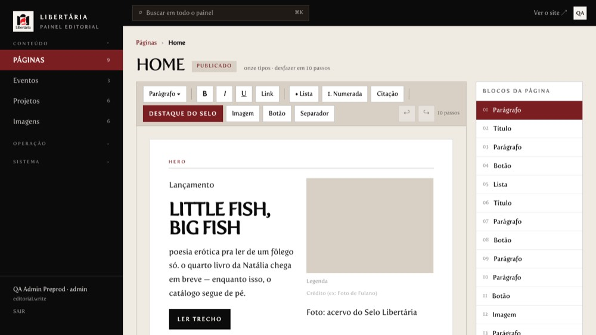
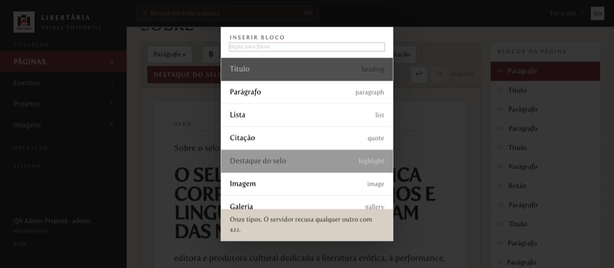
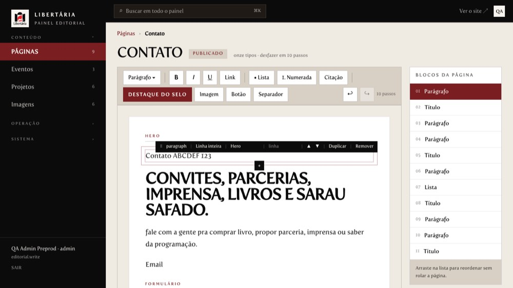
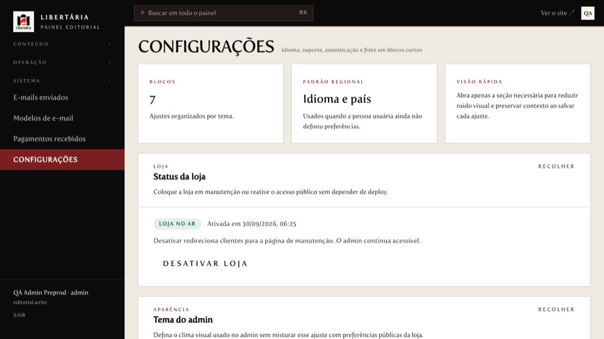
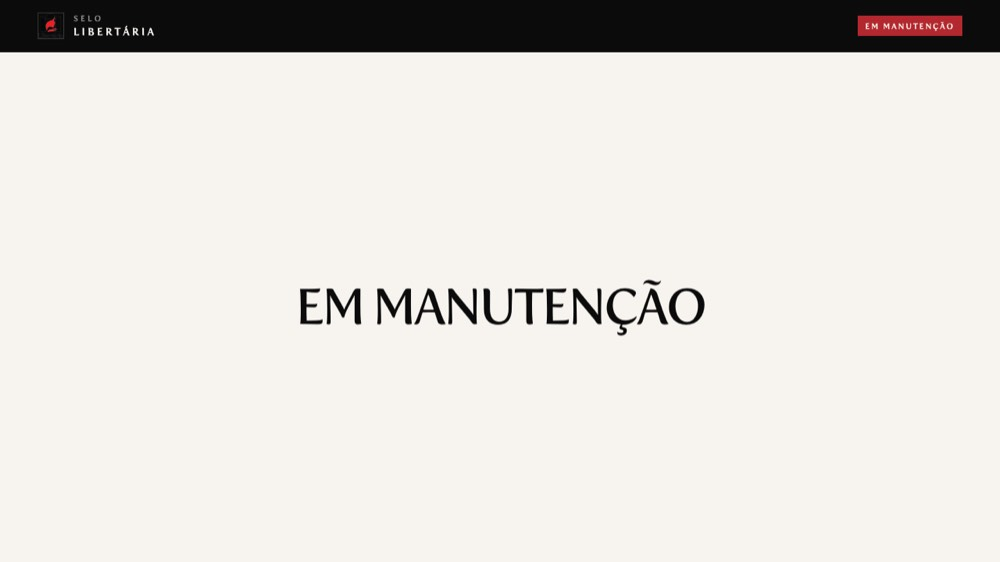
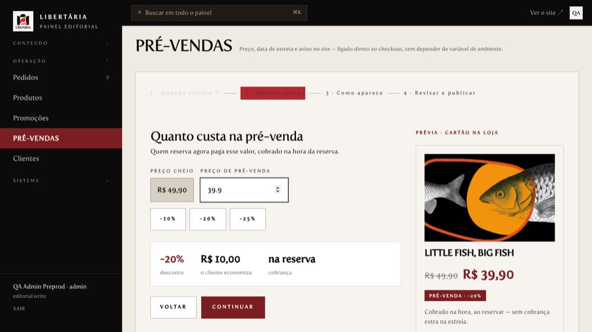
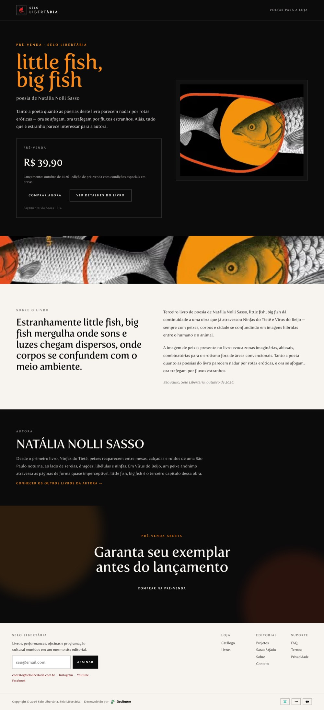
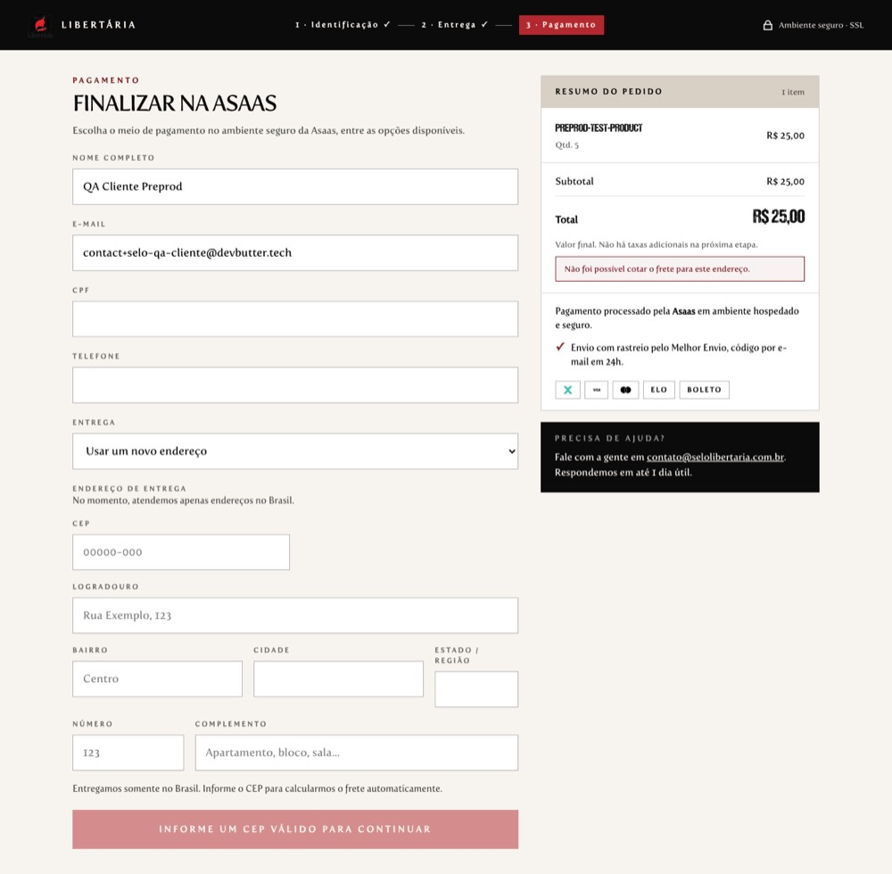
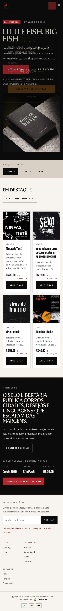

# QA E2E em preprod — 2026-09-30

Suíte Playwright `e2e/journeys/preprod-qa` contra **https://preprod.selolibertaria.com.br** (API `api-preprod.selolibertaria.com.br`), com contas de teste fixas e screenshot de cada passo.

**Resultado da última rodada: 74 ✅ passaram · 0 ❌ falharam · 3 ⏭️ puladas (condicionais).** Mais o smoke do projeto (`e2e/journeys/preprod/checkout-smoke.spec.ts`): ❌ bloqueado pela chave do Asaas (ver _Pendências_).

## Ambientes (estado ao fim da rodada)

| Ambiente | Estado |
|---|---|
| **Preprod** | loja **ativada** (`activated=true`) para permitir os testes; código = `master` (store `621be47`+, backend `818f4b8`); seeds: catálogo (3 livros + `preprod-test-product` R$ 5,00), editorial (9 páginas), pré-venda publicada |
| **Produção** | **em manutenção** (`activated=false`; `/` → `/maintenance`); chave interna rotacionada; editorial semeado (9 páginas, home sem a foto); admin acessível em manutenção |

## Credenciais de teste (preprod)

| Papel | E-mail |
|---|---|
| Admin | `contact+selo-qa-admin@devbutter.tech` |
| Cliente | `contact+selo-qa-cliente@devbutter.tech` |

As **senhas ficam só em `.env.e2e.preprod.local`** (arquivo local, ignorado pelo git, permissão 600). Para rodar:

```bash
set -a; . ./.env.e2e.preprod.local; set +a
yarn playwright test e2e/journeys/preprod-qa   # 01 faz o login que 02–08 reaproveitam
```

## Resultados por área

### Manutenção e login (`01-maintenance-gate`)

| Teste | Resultado | Tempo |
|---|---|---|
| public API reports the maintenance state | ✅ | 0.3s |
| anonymous visitors are sent to /maintenance (or see the open store if already activated) | ✅ | 1.4s |
| login page stays reachable during maintenance | ✅ | 0.8s |
| wrong password shows a specific message, not a server error | ✅ | 1.4s |
| admin logs in and lands in /admin even while the store is in maintenance | ✅ | 1.7s |
| customer (non-admin) cannot log in during maintenance and sees why | ⏭️ | 0.1s |

<details><summary>Screenshots (4)</summary>

- `admin-dashboard-after-login` — [ver](screenshots/01-maintenance-gate--admin-dashboard-after-login.jpg)
- `home-store-open` — [ver](screenshots/01-maintenance-gate--home-store-open.jpg)
- `login-invalid-credentials` — [ver](screenshots/01-maintenance-gate--login-invalid-credentials.jpg)
- `login-page` — [ver](screenshots/01-maintenance-gate--login-page.jpg)

</details>

### Admin: todas as telas (`02-admin-tour`)

| Teste | Resultado | Tempo |
|---|---|---|
| admin screen /admin renders cleanly | ✅ | 1.3s |
| admin screen /admin/editorial renders cleanly | ✅ | 2.1s |
| admin screen /admin/editorial/events renders cleanly | ✅ | 1.5s |
| admin screen /admin/editorial/projects renders cleanly | ✅ | 1.5s |
| admin screen /admin/media renders cleanly | ✅ | 2.0s |
| admin screen /admin/orders renders cleanly | ✅ | 1.3s |
| admin screen /admin/products renders cleanly | ✅ | 1.3s |
| admin screen /admin/products/new renders cleanly | ✅ | 1.4s |
| admin screen /admin/products/categories renders cleanly | ✅ | 1.3s |
| admin screen /admin/promotions renders cleanly | ✅ | 1.3s |
| admin screen /admin/pre-venda renders cleanly | ✅ | 1.2s |
| admin screen /admin/users renders cleanly | ✅ | 1.3s |
| admin screen /admin/emails renders cleanly | ✅ | 1.2s |
| admin screen /admin/email-templates renders cleanly | ✅ | 1.2s |
| admin screen /admin/webhooks renders cleanly | ✅ | 1.7s |
| admin screen /admin/settings renders cleanly | ✅ | 2.2s |
| admin sidebar navigation reaches every section by click | ✅ | 3.2s |
| admin shows the maintenance notice with the store toggle shortcut while deactivated | ⏭️ | 0.1s |

<details><summary>Screenshots (17)</summary>

- `admin-categorias` — [ver](screenshots/02-admin-tour--admin-categorias.jpg)
- `admin-clientes` — [ver](screenshots/02-admin-tour--admin-clientes.jpg)
- `admin-configuracoes` — [ver](screenshots/02-admin-tour--admin-configuracoes.jpg)
- `admin-dashboard` — [ver](screenshots/02-admin-tour--admin-dashboard.jpg)
- `admin-editorial-eventos` — [ver](screenshots/02-admin-tour--admin-editorial-eventos.jpg)
- `admin-editorial-paginas` — [ver](screenshots/02-admin-tour--admin-editorial-paginas.jpg)
- `admin-editorial-projetos` — [ver](screenshots/02-admin-tour--admin-editorial-projetos.jpg)
- `admin-emails-enviados` — [ver](screenshots/02-admin-tour--admin-emails-enviados.jpg)
- `admin-imagens` — [ver](screenshots/02-admin-tour--admin-imagens.jpg)
- `admin-modelos-de-email` — [ver](screenshots/02-admin-tour--admin-modelos-de-email.jpg)
- `admin-pagamentos-recebidos` — [ver](screenshots/02-admin-tour--admin-pagamentos-recebidos.jpg)
- `admin-pedidos` — [ver](screenshots/02-admin-tour--admin-pedidos.jpg)
- `admin-pre-vendas` — [ver](screenshots/02-admin-tour--admin-pre-vendas.jpg)
- `admin-produto-novo` — [ver](screenshots/02-admin-tour--admin-produto-novo.jpg)
- `admin-produtos` — [ver](screenshots/02-admin-tour--admin-produtos.jpg)
- `admin-promocoes` — [ver](screenshots/02-admin-tour--admin-promocoes.jpg)
- `sidebar-last-section` — [ver](screenshots/02-admin-tour--sidebar-last-section.jpg)

</details>

### Editorial (editor de blocos) (`03-editorial-editor`)

| Teste | Resultado | Tempo |
|---|---|---|
| is a centred modal with its own scrolling list | ✅ | 1.4s |
| closes when clicking outside it | ✅ | 1.4s |
| closes with Escape | ✅ | 1.3s |
| inserting a type closes it and adds the block | ✅ | 2.8s |
| editor loads the saved document for "Home" (home) | ✅ | 0.7s |
| editor loads the saved document for "Loja" (products) | ✅ | 0.6s |
| editor loads the saved document for "Página do produto" (product) | ✅ | 0.7s |
| editor loads the saved document for "Eventos" (events) | ✅ | 0.7s |
| editor loads the saved document for "Projetos" (projects) | ✅ | 0.7s |
| editor loads the saved document for "Sobre" (about) | ✅ | 0.6s |
| editor loads the saved document for "Contato" (contact) | ✅ | 0.7s |
| editor loads the saved document for "Sarau Safado" (sarau-safado) | ✅ | 0.6s |
| editor loads the saved document for "Newsletter e rodapé" (public-global) | ✅ | 0.6s |
| typed text comes out in order (regression: text written backwards) | ✅ | 2.7s |
| autosave persisted the draft: a reload still shows the typed text | ✅ | 0.7s |
| 'Voltar ao publicado' discards the draft back to what is live | ✅ | 0.8s |
| publish round trip on Sarau Safado, then restore what was live | ✅ | 5.5s |
| image upload works end to end and the returned URL is public | ✅ | 3.4s |
| the editor API path the page uses answers the list for every editorial type (no 401) | ✅ | 0.1s |

<details><summary>Screenshots (15)</summary>

- `draft-survives-reload` — [ver](screenshots/03-editorial-editor--draft-survives-reload.jpg)
- `editor-about` — [ver](screenshots/03-editorial-editor--editor-about.jpg)
- `editor-contact` — [ver](screenshots/03-editorial-editor--editor-contact.jpg)
- `editor-events` — [ver](screenshots/03-editorial-editor--editor-events.jpg)
- `editor-home` — [ver](screenshots/03-editorial-editor--editor-home.jpg)
- `editor-product` — [ver](screenshots/03-editorial-editor--editor-product.jpg)
- `editor-products` — [ver](screenshots/03-editorial-editor--editor-products.jpg)
- `editor-projects` — [ver](screenshots/03-editorial-editor--editor-projects.jpg)
- `editor-public-global` — [ver](screenshots/03-editorial-editor--editor-public-global.jpg)
- `editor-sarau-safado` — [ver](screenshots/03-editorial-editor--editor-sarau-safado.jpg)
- `media-library-after-upload` — [ver](screenshots/03-editorial-editor--media-library-after-upload.jpg)
- `picker-centred-scrollable` — [ver](screenshots/03-editorial-editor--picker-centred-scrollable.jpg)
- `published-with-marker` — [ver](screenshots/03-editorial-editor--published-with-marker.jpg)
- `reverted-to-published` — [ver](screenshots/03-editorial-editor--reverted-to-published.jpg)
- `typing-in-order` — [ver](screenshots/03-editorial-editor--typing-in-order.jpg)

</details>

### Loja ativa/inativa pelo admin (`04-activation-toggle`)

| Teste | Resultado | Tempo |
|---|---|---|
| Settings shows the current store status and the control | ✅ | 0.7s |
| admin deactivates the store: customers get the maintenance page, admin keeps working | ✅ | 1.9s |
| admin activates the store: customers get the real site | ✅ | 1.8s |

<details><summary>Screenshots (6)</summary>

- `admin-editorial-while-deactivated` — [ver](screenshots/04-activation-toggle--admin-editorial-while-deactivated.jpg)
- `settings-store-activated` — [ver](screenshots/04-activation-toggle--settings-store-activated.jpg)
- `settings-store-deactivated` — [ver](screenshots/04-activation-toggle--settings-store-deactivated.jpg)
- `settings-store-status` — [ver](screenshots/04-activation-toggle--settings-store-status.jpg)
- `visitor-sees-maintenance` — [ver](screenshots/04-activation-toggle--visitor-sees-maintenance.jpg)
- `visitor-sees-store-home` — [ver](screenshots/04-activation-toggle--visitor-sees-store-home.jpg)

</details>

### Páginas públicas (desktop + mobile) (`05-public-pages`)

| Teste | Resultado | Tempo |
|---|---|---|
| public / renders (desktop + mobile) | ✅ | 1.9s |
| public /products renders (desktop + mobile) | ✅ | 1.9s |
| public /about renders (desktop) | ✅ | 1.3s |
| public /contact renders (desktop + mobile) | ✅ | 1.8s |
| public /events renders (desktop) | ✅ | 1.7s |
| public /projects renders (desktop) | ✅ | 1.5s |
| public /sarau-safado renders (desktop) | ✅ | 1.3s |
| public /faq renders (desktop) | ✅ | 1.3s |
| public /privacy renders (desktop) | ✅ | 1.0s |
| public /terms renders (desktop) | ✅ | 1.2s |
| public /login renders (desktop + mobile) | ✅ | 1.5s |
| public /reset-password renders (desktop) | ✅ | 0.9s |
| public /search?q=livro renders (desktop) | ✅ | 1.3s |
| published editorial copy reaches the page (home shows the seeded hero text) | ✅ | 0.7s |
| catalog: every published product opens its page | ✅ | 3.1s |
| an editorial project detail page opens | ⏭️ | 0.1s |
| unknown URLs show the friendly 404, not a crash | ✅ | 0.4s |
| protected pages send an anonymous visitor to /login | ✅ | 0.9s |

<details><summary>Screenshots (23)</summary>

- `404` — [ver](screenshots/05-public-pages--404.jpg)
- `busca-desktop` — [ver](screenshots/05-public-pages--busca-desktop.jpg)
- `contato-desktop` — [ver](screenshots/05-public-pages--contato-desktop.jpg)
- `contato-mobile` — [ver](screenshots/05-public-pages--contato-mobile.jpg)
- `eventos-desktop` — [ver](screenshots/05-public-pages--eventos-desktop.jpg)
- `faq-desktop` — [ver](screenshots/05-public-pages--faq-desktop.jpg)
- `home-desktop` — [ver](screenshots/05-public-pages--home-desktop.jpg)
- `home-mobile` — [ver](screenshots/05-public-pages--home-mobile.jpg)
- `login-desktop` — [ver](screenshots/05-public-pages--login-desktop.jpg)
- `login-mobile` — [ver](screenshots/05-public-pages--login-mobile.jpg)
- `loja-desktop` — [ver](screenshots/05-public-pages--loja-desktop.jpg)
- `loja-mobile` — [ver](screenshots/05-public-pages--loja-mobile.jpg)
- `privacidade-desktop` — [ver](screenshots/05-public-pages--privacidade-desktop.jpg)
- `produto-little-fish-big-fish` — [ver](screenshots/05-public-pages--produto-little-fish-big-fish.jpg)
- `produto-ninfas-do-tiete` — [ver](screenshots/05-public-pages--produto-ninfas-do-tiete.jpg)
- `produto-preprod-test-product` — [ver](screenshots/05-public-pages--produto-preprod-test-product.jpg)
- `produto-sexo-estranho-com-desconhecidos-em-lugares-improprios` — [ver](screenshots/05-public-pages--produto-sexo-estranho-com-desconhecidos-em-lugares-improprios.jpg)
- `produto-virus-do-beijo` — [ver](screenshots/05-public-pages--produto-virus-do-beijo.jpg)
- `projetos-desktop` — [ver](screenshots/05-public-pages--projetos-desktop.jpg)
- `reset-password-desktop` — [ver](screenshots/05-public-pages--reset-password-desktop.jpg)
- `sarau-safado-desktop` — [ver](screenshots/05-public-pages--sarau-safado-desktop.jpg)
- `sobre-desktop` — [ver](screenshots/05-public-pages--sobre-desktop.jpg)
- `termos-desktop` — [ver](screenshots/05-public-pages--termos-desktop.jpg)

</details>

### Comprador: login, carrinho, checkout (`06-shopper-checkout`)

| Teste | Resultado | Tempo |
|---|---|---|
| adds the test product to the cart and sees the R$ 5,00 total | ✅ | 1.1s |
| checkout page loads for the signed-in buyer with the cart and the pay button | ✅ | 10.5s |
| cart can be emptied and the page says so | ✅ | 0.5s |
| customer logs in and lands on the storefront with the right role | ✅ | 2.9s |

<details><summary>Screenshots (8)</summary>

- `cart-drawer-with-item` — [ver](screenshots/06-shopper-checkout--cart-drawer-with-item.jpg)
- `checkout-after-remove-attempt` — [ver](screenshots/06-shopper-checkout--checkout-after-remove-attempt.jpg)
- `checkout-signed-in` — [ver](screenshots/06-shopper-checkout--checkout-signed-in.jpg)
- `customer-account` — [ver](screenshots/06-shopper-checkout--customer-account.jpg)
- `customer-after-login` — [ver](screenshots/06-shopper-checkout--customer-after-login.jpg)
- `customer-orders` — [ver](screenshots/06-shopper-checkout--customer-orders.jpg)
- `pdp-test-product` — [ver](screenshots/06-shopper-checkout--pdp-test-product.jpg)
- `pdp-with-presale-notice` — [ver](screenshots/06-shopper-checkout--pdp-with-presale-notice.jpg)

</details>

### Pré-venda (`07-presale`)

| Teste | Resultado | Tempo |
|---|---|---|
| wizard shows prices in reais (R$ 49,90), not centavos (R$ 4990,00) | ✅ | 0.9s |
| publishing right after editing publishes the NEW values (no stale autosave) | ✅ | 2.0s |
| admin list shows the live presale with the right amounts | ✅ | 0.6s |
| landing page shows R$ 39,90 and R$ 49,90 with the launch date | ✅ | 0.8s |
| the presale notice on other pages shows the discount in reais | ✅ | 0.7s |
| reserving puts the presale price in the cart (centavos end to end) | ✅ | 1.9s |

<details><summary>Screenshots (8)</summary>

- `admin-presale-live` — [ver](screenshots/07-presale--admin-presale-live.jpg)
- `after-reserve-click` — [ver](screenshots/07-presale--after-reserve-click.jpg)
- `landing` — [ver](screenshots/07-presale--landing.jpg)
- `presale-list-after-publish` — [ver](screenshots/07-presale--presale-list-after-publish.jpg)
- `presale-notice-home` — [ver](screenshots/07-presale--presale-notice-home.jpg)
- `wizard-price-39-90-minus-20` — [ver](screenshots/07-presale--wizard-price-39-90-minus-20.jpg)
- `wizard-price-step` — [ver](screenshots/07-presale--wizard-price-step.jpg)
- `wizard-review` — [ver](screenshots/07-presale--wizard-review.jpg)

</details>

### Admin: produtos, clientes, logout (`08-admin-operations`)

| Teste | Resultado | Tempo |
|---|---|---|
| each seeded product opens in the admin editor | ✅ | 3.0s |
| customers list shows the QA accounts and opens a detail page | ✅ | 1.0s |
| logout clears the admin session | ✅ | 1.1s |

<details><summary>Screenshots (8)</summary>

- `after-logout-admin-redirects-to-login` — [ver](screenshots/08-admin-operations--after-logout-admin-redirects-to-login.jpg)
- `customer-detail` — [ver](screenshots/08-admin-operations--customer-detail.jpg)
- `customers-list` — [ver](screenshots/08-admin-operations--customers-list.jpg)
- `product-little-fish-big-fish` — [ver](screenshots/08-admin-operations--product-little-fish-big-fish.jpg)
- `product-ninfas-do-tiete` — [ver](screenshots/08-admin-operations--product-ninfas-do-tiete.jpg)
- `product-preprod-test-product` — [ver](screenshots/08-admin-operations--product-preprod-test-product.jpg)
- `product-sexo-estranho-com-desconhecidos-em-lugares-improprios` — [ver](screenshots/08-admin-operations--product-sexo-estranho-com-desconhecidos-em-lugares-improprios.jpg)
- `product-virus-do-beijo` — [ver](screenshots/08-admin-operations--product-virus-do-beijo.jpg)

</details>


## Destaques visuais

| O que | Screenshot |
|---|---|
| Editor da Home carregando o documento salvo (foto no blob real) |  |
| Menu "+" como modal centralizado, rolável (tela curta) |  |
| Texto digitado na ordem certa (teclado real) |  |
| Loja ativada/desativada pelo admin (Configurações) |  |
| Visitante em manutenção |  |
| Pré-venda: assistente com R$ 39,90 (−20%) |  |
| Pré-venda: landing pública (R$ 39,90, sem a seção interna de componentes) |  |
| Checkout do comprador logado (R$ 5,00/unidade) |  |
| Home no celular |  |

## Bugs achados e corrigidos nesta sessão (todos com issue)

| # | Issue | Estado |
|---|---|---|
| store#199 | Editor: texto digitado ao contrário | ✅ corrigido (PR #204) |
| store#200 | Editor: menu "+" não fecha / não centralizado / sem rolagem | ✅ corrigido (PR #204) |
| store#201 | Admin engolia 401/5xx e abria página vazia | ✅ corrigido (PR #204) |
| backend#85 | Rascunho 404 em página sem registro | ✅ corrigido (PR #86) |
| store#205 | Admin inacessível com a loja em manutenção | ✅ corrigido (PR #206) |
| store#198 | Login: conta bloqueada/manutenção sem mensagem própria | ✅ corrigido (PR #207) |
| store#209 | `/maintenance` e `/login` faziam `GET /api/cart` → 503 | ✅ corrigido (PR #210) |
| store#211 | `BUTTER_BLOB_PUBLIC_HOST` inválido/placeholder | ✅ código (PR #212) + envs |
| store#213 | Blocos novos do editor não apareciam no site | ✅ corrigido (PR #214) |
| store#215 | Pré-venda: centavos exibidos como reais (R$ 4990,00, −99%) | ✅ corrigido (PR #217) |
| store#216 | Pré-venda: "Publicar" logo após editar publicava o rascunho antigo | ✅ corrigido (PR #217) |
| store#219/#220 | Landing de pré-venda: vitrine interna exposta e "agosto de 2026" fixo | ✅ corrigido (PR #221) |
| store#222 | Hidratação React #418 em Configurações (fuso) | ✅ corrigido (PR #223) |
| backend#82/#83 | Migration de reparo do `site_activation` / testes herméticos | ✅ (PR #84) |
| backend#88/#90/#96 | `BUTTER_BLOB_BASE_URL` https, seed do editorial frágil, Asaas 301/HTML virava 500 | ✅ (envs, PR #91, PR #97) |
| backend#92/#93/#95(preprod) | Coolify de preprod com banco de produção; blob sem `PUBLIC_BASE_URL`; Melhor Envio sandbox vs produção | ✅ corrigido no Coolify |

**Abertas (baixa severidade):** store#218 (aviso de frete antes do CEP para cliente sem endereço salvo) · backend#94 (URL pública do blob responde 404 por ~1 s após o upload).

## Pendências que dependem da dona/dono (bloqueiam o lançamento)

1. **Chave do Asaas válida** — [backend#98](https://github.com/acidevbutter/selolibertaria_backend/issues/98). As chaves atuais são rejeitadas (`invalid_access_token`); sem isso nenhum checkout cria cobrança (preprod e produção). Recomendado: chave de **sandbox** + `https://sandbox.asaas.com/api/v3` no preprod.
2. **Token de produção do Melhor Envio** — [backend#95](https://github.com/acidevbutter/selolibertaria_backend/issues/95). O token é de sandbox; em produção a cotação de frete dá 401.
3. **Chave AWS válida do blob de produção** — [backend#89](https://github.com/acidevbutter/selolibertaria_backend/issues/89). `InvalidAccessKeyId`: sem ela não há upload de imagens em produção (inclui o editor).
4. **Catálogo de produção** ainda não semeado (preços do seed: R$ 49, 78 e 58 — confirmar antes).
5. Decidir se o preprod terá teto de preço (`store_settings.priceCapCents`): hoje **não tem**, e o livro custa R$ 49,90 de verdade no Asaas real.

## Avisos para quem for testar amanhã

- **Checkout/pré-venda no preprod**: usa o Asaas **real** (com a chave correta, cobra de verdade). O produto `preprod-test-product` custa R$ 5,00 (mínimo do Asaas); o frete vem do sandbox do Melhor Envio (≈ R$ 12–35 a mais no total). Os testes automatizados **nunca pagam**.
- A **pré-venda está publicada** no preprod (R$ 39,90, estreia em ~21 dias) e o aviso aparece alguns segundos depois de abrir qualquer página — comportamento esperado; "Agora não" dispensa.
- Os testes mexem em conteúdo e depois restauram (rascunho → "Voltar ao publicado"; parágrafo de teste publicado e removido em Sarau Safado). O teste de upload deixa 1 imagem de 1×1 px na biblioteca de mídia.
- O teste de logout (08) invalida a sessão do admin: para rodar 02–08 isolados, rode antes o login (`-g "admin logs in"` do 01).

## Cobertura e limites

Cobre: portão de manutenção, login, todas as telas do admin, editor nas 9 páginas (digitação, autosave, modal, publicar/restaurar, upload), ativar/desativar loja, páginas públicas em desktop e mobile (imagens carregadas, sem erros de console/5xx), catálogo, produto, checkout até a tela de pagamento, pré-venda ponta a ponta (assistente → API → landing → aviso → carrinho em centavos).
Não cobre (precisa de credenciais externas válidas): pagamento no Asaas, cálculo de frete em produção, e-mails transacionais, upload de imagem em produção.
